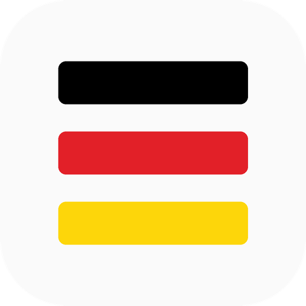

<p align="center"></p>

<h1 align="center">Edgy</h1>

<p align="center">Eine eigene Programmiersprache – auf Deutsch.</p>

---

## Download

Die neueste **Edgy.exe** gibt's unter [Releases](../../releases/latest).

Einfach starten, unten in der Taskleiste Rechtsklick auf das Symbol → **An Taskleiste anheften**.

Updates kommen automatisch: Edgy schaut beim Start nach einer neuen Version und tauscht sich selbst aus.

---

## So sieht Edgy aus

```
frag name "Wie heißt du?"
farbe "gold"
gib aus "Hi " + name + "!"
farbe "normal"

zähl i von 1 bis 3
  gib aus "Runde " + i
ende

merk wurf = zufall(1, 6)
wenn wurf == 6 dann
  gib aus "Eine 6!"
sonst
  gib aus "Gewürfelt: " + wurf
ende
```

---

## Befehle

| Befehl | Was er macht |
|---|---|
| `gib aus "Text"` | Text anzeigen |
| `merk name = wert` | Etwas speichern |
| `frag name "Frage?"` | Den Nutzer etwas fragen |
| `farbe "rot"` | Ausgabe einfärben (`"normal"` = zurück) |
| `leere` | Fenster leeren |
| `warte 2` | 2 Sekunden warten |
| `wenn ... dann` / `sonst` / `ende` | Entscheidung |
| `wiederhol 3 mal` / `ende` | Schleife |
| `solange x < 10` / `ende` | Schleife mit Bedingung |
| `zähl i von 1 bis 10` / `ende` | Zählschleife |
| `abbrechen` | Schleife verlassen |
| `# ...` | Kommentar |

**Funktionen:** `zufall(1, 6)` `länge(text)` `groß(text)` `klein(text)` `runde(3.7)` `wurzel(16)` `zahl("5")` `text(5)` `uhrzeit()` `datum()`

Rechnen: `+ - * / %` · Vergleichen: `== != < > <= >= ist` · Logik: `und oder nicht wahr falsch`

---

## Webseiten bauen

```
seite "Meine Seite"
hintergrund "schwarz"
textfarbe "weiß"
überschrift "Hallo, Welt!"
absatz "Gebaut mit Edgy."
knopf "Zu Google" zu "https://google.de"
```

Beim Start öffnet sich die Seite automatisch im Browser. Weitere Befehle: `link "Text" zu "url"`, `bild "url"`, `trennlinie`, `zeig seite`.

---

## Die Entwicklungsumgebung

- **Explorer** links – Ordner und Dateien, mit Rechtsklick: neue Datei, neuer Ordner, umbenennen, löschen (Papierkorb)
- **Tabs** – mehrere Dateien gleichzeitig offen, ● zeigt ungespeicherte Änderungen
- **Editor** – Farben, Zeilennummern, automatisches Einrücken
- **Vorschläge** – beim Tippen erscheint grau ein Vorschlag, **Tab** übernimmt ihn
- **Konsole** unten – Ausgaben sehen und Befehle direkt eintippen
- **▶ Starten** oder **F5** – Datei ausführen · **Esc** stoppt

Tasten: `Strg+N` neue Datei · `Strg+S` speichern · `Strg+O` öffnen · `Strg+W` Tab schließen · `Strg+B` Explorer · `Strg+J` Konsole · `Strg+Tab` nächster Tab

Standard-Ordner: *Dokumente\Edgy* (oben im Explorer kannst du einen anderen Ordner öffnen).

---

## Neue Version rausbringen

1. Code ändern
2. In `edgy/version.py` die Nummer hochzählen (z. B. `0.2.0` → `0.3.0`)
3. Hochladen – GitHub testet alles und baut die neue `Edgy.exe` automatisch
